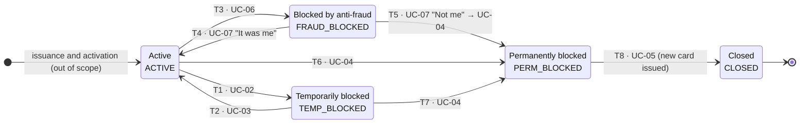

# Bank Card Management in a Mobile App

A system analyst case study covering requirements, a state model, integrations, API and data model for card management features (blocking, unblocking, reissue, response to anti-fraud alerts) in the mobile app of a fictional bank, **The Bank**.

## Problem and Goal

A customer who has lost their card or has spotted a suspicious transaction needs to protect their money within seconds, without calling the bank. The bank needs blocking to be applied reliably and irreversible actions to never happen by accident.

**The goal** is to let customers do the following procedures in the app:
- temporarily block and unblock a card;
- permanently block a lost or stolen card and order a replacement;
- respond quickly when the anti-fraud system automatically blocks their card.

## Scope

### Actors

| Actor | Type | Role |
|---|---|---|
| Customer | User | Mobile app user and cardholder |
| Anti-fraud system | External system | Initiates blocking when a suspicious transaction is detected |
| Card processing center | External system | Enforces card status during transaction authorization |

### Use Cases (core)

| ID | Name | Initiator | Level of detail |
|---|---|---|---|
| [UC-01](docs/02-requirements/use-cases/UC-01-card-list.md) | View cards | Customer | Brief |
| [UC-02](docs/02-requirements/use-cases/UC-02-temp-block.md) | Temporarily block a card | Customer | **Fully dressed** |
| [UC-03](docs/02-requirements/use-cases/UC-03-unblock.md) | Unblock a card | Customer | Brief |
| [UC-04](docs/02-requirements/use-cases/UC-04-perm-block.md) | Permanently block a lost or stolen card | Customer | Brief |
| [UC-05](docs/02-requirements/use-cases/UC-05-reissue.md) | Reissue a card | Customer | **Fully dressed** |
| [UC-06](docs/02-requirements/use-cases/UC-06-fraud-block.md) | Block a card on an anti-fraud alert | Anti-fraud system | Brief |
| [UC-07](docs/02-requirements/use-cases/UC-07-fraud-confirm.md) | Confirm or reject a suspicious transaction | Customer | **Fully dressed** |

### Out of Scope

Card issuance and activation, spending limits, block history, blocking by a contact center agent, migrating recurring payments, closing a card without reissue.


## Card State Model



Full transition table, guard conditions and forbidden transitions: [card-lifecycle.md](docs/03-state-model/card-lifecycle.md).

---

## Repository Structure

```
card-management-sa-case/
├── README.md                         ← you are here
├── docs/
│   ├── 01-context/
│   │   ├── vision.md                 ← problem, goals, success metrics
│   │   ├── glossary.md               ← terms and statuses
│   │   └── context-diagram.md        ← C4 Level 1: system and its environment
│   ├── 02-requirements/
│   │   ├── business-requirements.md
│   │   ├── nfr.md                    ← performance, security, audit
│   │   ├── user-stories.md           ← stories with acceptance criteria (Gherkin)
│   │   └── use-cases/
│   │       ├── UC-01-card-list.md
│   │       ├── UC-02-temp-block.md
│   │       ├── UC-03-unblock.md
│   │       ├── UC-04-perm-block.md
│   │       ├── UC-05-reissue.md
│   │       ├── UC-06-fraud-block.md
│   │       └── UC-07-fraud-confirm.md
│   ├── 03-state-model/
│   │   └── card-lifecycle.md         ← state diagram + transition table
│   ├── 04-architecture/
│   │   ├── containers.md             ← C4 Level 2: services
│   │   └── sequences/
│   │       ├── SD-UC-02-temp-block.md
│   │       ├── SD-UC-05-reissue-saga.md
│   │       └── SD-UC-06-07-fraud.md
│   └── 05-decisions/
│       ├── ADR-001-block-reason-as-attribute.md
│       ├── ADR-002-reissue-as-new-entity.md
│       └── ADR-003-reissue-saga-orchestration.md
├── api/
│   └── card-api.openapi.yaml         ← REST API for the mobile app
├── events/
│   └── card-events.asyncapi.yaml     ← event contracts (Kafka)
└── db/
    ├── erd.md                        ← ERD in Mermaid
    ├── schema.sql                    ← DDL, PostgreSQL
    └── queries.sql                   ← analytical queries
```

---

## Key Design Decisions

| ADR | Decision | Rationale |
|---|---|---|
| [ADR-001](docs/05-decisions/ADR-001-block-reason-as-attribute.md) | The block reason (LOST, STOLEN, FRAUD_CONFIRMED) is stored as an attribute, not as separate statuses | Keeps the state model compact; new reasons don't require new transitions |
| [ADR-002](docs/05-decisions/ADR-002-reissue-as-new-entity.md) | A reissued card is a new entity with its own lifecycle | The old card keeps its history; the link is stored in the reissue request |
| [ADR-003](docs/05-decisions/ADR-003-reissue-saga-orchestration.md) | Reissue is implemented as an orchestrated saga with compensating actions | Steps span several services and the external processing center; consistency is needed without distributed transactions |

---

## Skills Demonstrated

| Skill | Where to look |
|---|---|
| Requirements elicitation and specification | `business-requirements.md`, `user-stories.md`, `use-cases/` |
| Non-functional requirements | `nfr.md` |
| State modeling | `card-lifecycle.md` |
| Architecture and integrations (C4, sequence diagrams) | `04-architecture/` |
| Distributed transactions (saga, compensations, idempotency) | `SD-UC-05-reissue-saga.md`, `ADR-003` |
| REST API design (OpenAPI 3) | `api/card-api.openapi.yaml` |
| Asynchronous messaging (AsyncAPI, Kafka) | `events/card-events.asyncapi.yaml` |
| Data modeling and SQL (PostgreSQL) | `db/` |
| Architecture decision records | `05-decisions/` |

**Notations and tools:** UML (use case, state, sequence), C4, Mermaid, PlantUML, OpenAPI 3.0, AsyncAPI 2.6, Gherkin, PostgreSQL.

---

## Status

- [x] Scope and use case list
- [x] Card state model
- [ ] Vision, glossary, context diagram
- [ ] Business requirements and NFRs
- [ ] Use cases UC-01…UC-07
- [ ] User stories with acceptance criteria
- [ ] C4 Level 2 and sequence diagrams
- [ ] ADR-001…003
- [ ] OpenAPI specification
- [ ] Event contracts
- [ ] ERD, DDL and queries

---

## Author

**Alina Vlasova**, System Analyst
Telegram: `@...` · Email: `...` · [CV](...)