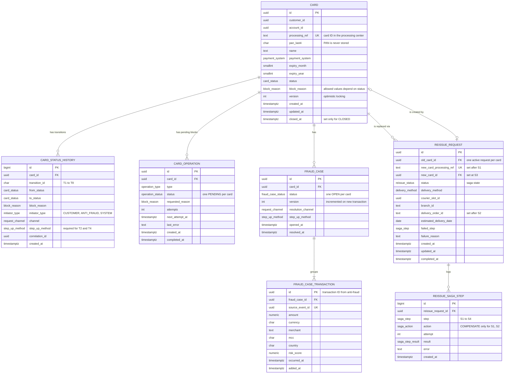
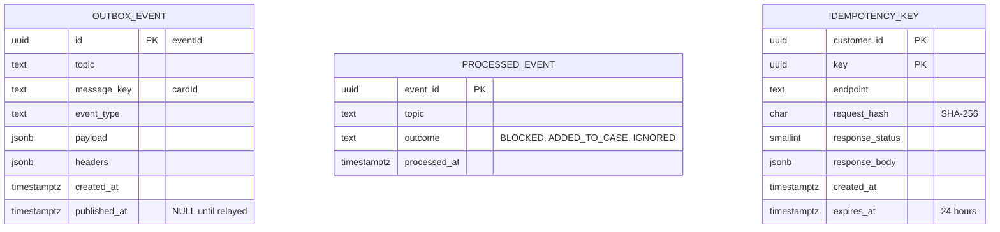

# Data Model (ERD)

The database of the Card Service (PostgreSQL). DDL: [schema.sql](schema.sql). Analytical queries: [queries.sql](queries.sql).

Related: [README](../README.md) · [Card lifecycle](../docs/03-state-model/card-lifecycle.md) · [Containers](../docs/04-architecture/containers.md)

## Domain Tables

## Integration Tables

These tables have no foreign keys to the domain tables: they support reliable messaging and idempotency rather than describing the domain.

## Tables

| Table | Purpose | Use cases |
|---|---|---|
| `card` | Current state of each card. A reissued card is a new row. | All |
| `card_status_history` | Append-only log of transitions T1–T8 for audit, support and analytics | All status changes |
| `card_operation` | Block operations waiting for the processing center, retried in the background | UC-02 ext. 6a, UC-04 ext. 8a |
| `fraud_case` | Customer's pending decision about suspicious transactions on a card | UC-06, UC-07 |
| `fraud_case_transaction` | Suspicious transactions in a fraud case | UC-06, UC-07 |
| `reissue_request` | Reissue order and persisted saga state | UC-05 |
| `reissue_saga_step` | Every execution and compensation attempt of the saga | UC-05 |
| `outbox_event` | Transactional outbox for Kafka events | All status changes, UC-05 |
| `processed_event` | Anti-fraud events already processed (idempotent consumer) | UC-06 |
| `idempotency_key` | Stored API responses by idempotency key | All `POST` endpoints |

## Business Rules Enforced by the Database

The Card Service checks these rules too, but the database rejects violating data even if the service has a bug.

| Rule | Mechanism |
|---|---|
| Only allowed transitions T1–T8 are recorded | `CHECK history_transition_chk` |
| Block reason matches the status | `CHECK card_status_reason_chk` |
| Unblocking (T2, T4) always records the step-up method | `CHECK history_step_up_chk` |
| Status history cannot be edited or deleted | Trigger `history_append_only` |
| At most one pending block operation per card | Partial unique index `operation_one_pending_per_card` |
| At most one open fraud case per card (BR-07-3) | Partial unique index `fraud_case_one_open_per_card` |
| At most one active reissue request per card (BR-05-2) | Partial unique index `reissue_one_active_per_card` |
| Only steps before the pivot can be compensated (BR-05-5) | `CHECK saga_compensation_chk` |
| An anti-fraud event is processed once (BR-06-4) | Primary key of `processed_event`, unique `source_event_id` |
| Courier delivery has a slot, branch pickup has a branch | `CHECK reissue_delivery_chk` |

## Design Decisions

- **No full card number.** Only the last four digits are stored; the processing center is the only system that holds the PAN. This keeps the Card Service out of the strictest PCI DSS scope.
- **Status in the row, history in a separate table.** The current status is read on every request and must be fast; the history is append-only and used for audit and analytics.
- **The new card row is created at the pivot step.** After S1 only the processing center's reference is stored in `reissue_request`. The `card` row for the new card is inserted in the same transaction that closes the old card (S3). A card cancelled by compensation therefore never appears in the customer's card list.
- **Partial unique indexes instead of application checks.** Rules like "one open fraud case per card" hold even when two requests arrive at the same moment, which an application-level check alone cannot guarantee.
- **Money as `numeric(18, 2)`.** Never floating point.
- **Enums as PostgreSQL types.** Statuses are fixed by the state model; adding a value is an explicit migration.