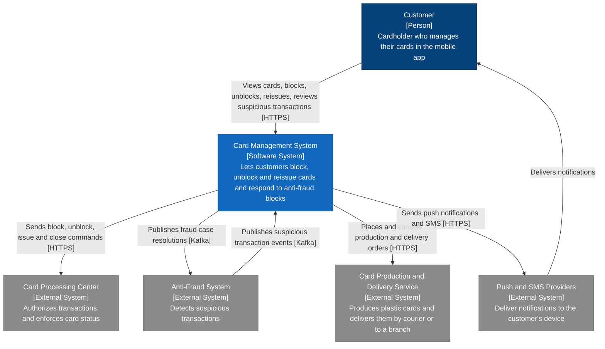

# System Context (C4 Level 1)

The card management system and the people and systems it interacts with. Internal structure is shown at the next level: [containers.md](../04-architecture/containers.md).

Related: [README](../../README.md) · [Glossary](glossary.md)

## Diagram

## Elements

| Element | Type | Responsibility | Owned by |
|---|---|---|---|
| Customer | Person | Uses the mobile app to manage their cards | — |
| Card Management System | Software system (in scope) | Card statuses, status history, fraud cases, reissue requests; orchestrates calls to external systems | The Bank, card management team |
| Card Processing Center | External system | Authorizes card transactions; holds the authoritative card status used at authorization; issues and closes card numbers | Processing provider |
| Anti-Fraud System | External system | Scores transactions in real time and reports suspicious ones | The Bank, anti-fraud team |
| Card Production and Delivery Service | External system | Produces cards, provides delivery slots and branches, delivers cards | Production and logistics partner |
| Push and SMS Providers | External system | Deliver push notifications (APNs, FCM) and SMS | Third-party providers |

## Interactions

| From | To | Purpose | Style | Use cases |
|---|---|---|---|---|
| Customer | Card Management System | All customer actions | Synchronous, HTTPS (REST) | UC-01 … UC-05, UC-07 |
| Card Management System | Card Processing Center | Block, unblock, issue new card, close card | Synchronous, HTTPS | UC-02 … UC-07 |
| Anti-Fraud System | Card Management System | `SuspiciousTransactionDetected` events | Asynchronous, Kafka | UC-06 |
| Card Management System | Anti-Fraud System | `FraudCaseResolved` events (feedback) | Asynchronous, Kafka | UC-07 |
| Card Management System | Card Production and Delivery Service | Delivery options, place and cancel orders | Synchronous, HTTPS | UC-05 |
| Card Management System | Push and SMS Providers | Customer notifications | Synchronous, HTTPS | UC-02 … UC-07 |