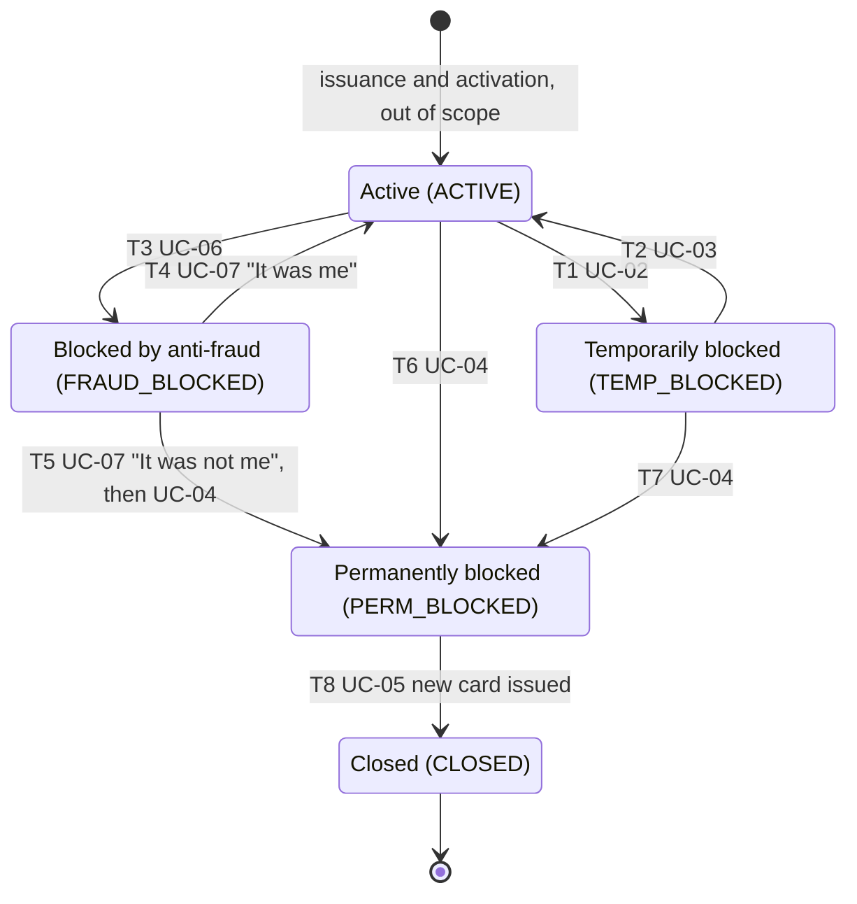

# Card Lifecycle

This document defines the card state model: statuses, allowed transitions, guard conditions and how the system handles requests that do not match the current status.

Related use cases: [UC-02](../02-requirements/use-cases/UC-02-temp-block.md), [UC-03](../02-requirements/use-cases/UC-03-unblock.md), [UC-04](../02-requirements/use-cases/UC-04-perm-block.md), [UC-05](../02-requirements/use-cases/UC-05-reissue.md), [UC-06](../02-requirements/use-cases/UC-06-fraud-block.md), [UC-07](../02-requirements/use-cases/UC-07-fraud-confirm.md)

## State Diagram

## Statuses

| Status | Description | Transactions | Customer actions available in the app |
|---|---|---|---|
| `ACTIVE` | Card is operational | Allowed | Temporary block (UC-02), permanent block (UC-04) |
| `TEMP_BLOCKED` | Blocked by the customer, reversible | Declined | Unblock (UC-03), permanent block (UC-04) |
| `FRAUD_BLOCKED` | Blocked by the anti-fraud system pending customer confirmation | Declined | Confirm or reject the suspicious transaction (UC-07) |
| `PERM_BLOCKED` | Blocked permanently, irreversible | Declined | Reissue (UC-05) |
| `CLOSED` | Replaced by a reissued card, terminal | Declined | View only |

### Block Reason

The reason is stored in a separate `block_reason` attribute.

| Status | Allowed `block_reason` values |
|---|---|
| `ACTIVE` | — |
| `TEMP_BLOCKED` | `CUSTOMER_REQUEST` |
| `FRAUD_BLOCKED` | `FRAUD_SUSPECTED` |
| `PERM_BLOCKED` | `LOST`, `STOLEN`, `FRAUD_CONFIRMED` |
| `CLOSED` | Keeps the value from `PERM_BLOCKED` |

## Transitions

| ID | From | To | Use case | Initiator | Guard condition | `block_reason` after |
|---|---|---|---|---|---|---|
| T1 | `ACTIVE` | `TEMP_BLOCKED` | UC-02 | Customer | — | `CUSTOMER_REQUEST` |
| T2 | `TEMP_BLOCKED` | `ACTIVE` | UC-03 | Customer | Successful confirmation via OTP or biometrics | — |
| T3 | `ACTIVE` | `FRAUD_BLOCKED` | UC-06 | Anti-fraud system | Suspicious transaction event received | `FRAUD_SUSPECTED` |
| T4 | `FRAUD_BLOCKED` | `ACTIVE` | UC-07 | Customer | Customer confirmed the transaction ("It was me") and passed confirmation | — |
| T5 | `FRAUD_BLOCKED` | `PERM_BLOCKED` | UC-07 → UC-04 | Customer | Customer did not recognize the transaction ("It was not me") | `FRAUD_CONFIRMED` |
| T6 | `ACTIVE` | `PERM_BLOCKED` | UC-04 | Customer | Reason selected: lost or stolen | `LOST` / `STOLEN` |
| T7 | `TEMP_BLOCKED` | `PERM_BLOCKED` | UC-04 | Customer | Reason selected: lost or stolen | `LOST` / `STOLEN` |
| T8 | `PERM_BLOCKED` | `CLOSED` | UC-05 | System | Replacement card successfully issued (reissue saga step) | Unchanged |

Every transition is recorded in the card status history with the transition ID, initiator, timestamp and reason. The history is used for audit and customer support.

## Requests That Do Not Match the Current Status

| Current status | Request | System behavior | Notes |
|---|---|---|---|
| `TEMP_BLOCKED` | Temporary block (UC-02) | Success, status unchanged, no event published | The action is idempotent: repeated taps or retries must not produce errors. |
| `ACTIVE` | Unblock (UC-03) | Success, status unchanged, no event published | The action is idempotent: repeated taps or retries must not produce errors. |
| `FRAUD_BLOCKED` | Temporary block (UC-02) | Rejected: card is already blocked | Anti-fraud block is stronger and must not be replaced by a reversible one |
| `FRAUD_BLOCKED` | Unblock (UC-03) | Rejected, customer is redirected to UC-07 | Only the customer's response to the suspicious transaction can lift an anti-fraud block |
| `TEMP_BLOCKED` | Anti-fraud event (UC-06) | Ignored, logged | No transactions are possible on a blocked card |
| `PERM_BLOCKED`, `CLOSED` | Any customer request except UC-05 on `PERM_BLOCKED` | Rejected | Statuses are irreversible |
| `PERM_BLOCKED`, `CLOSED` | Anti-fraud event (UC-06) | Ignored, logged | Card is already permanently blocked |

Error codes for rejected requests are defined in the [API specification](../../api/card-api.openapi.yaml).

## Reissued Card

A reissued card is a new entity with its own ID and lifecycle, starting from `ACTIVE`. 
The old card moves to `CLOSED`. 

The link between the two cards is stored in the reissue request.