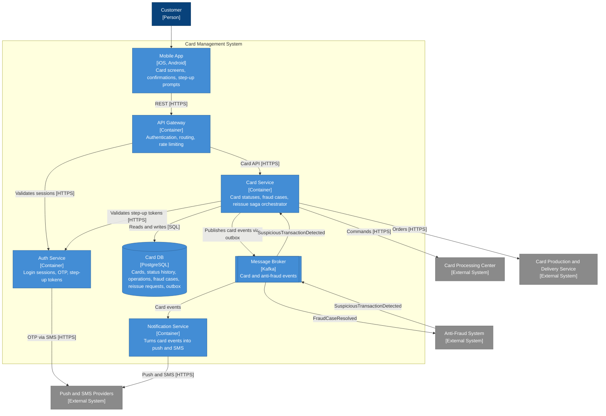

# Containers (C4 Level 2)

The internal structure of the card management system: deployable services, data stores and how they communicate. The system boundary is defined in the [context diagram](../01-context/context-diagram.md).

Related: [README](../../README.md) · Sequence diagrams: [UC-02](sequences/SD-UC-02-temp-block.md), [UC-05](sequences/SD-UC-05-reissue-saga.md), [UC-06/07](sequences/SD-UC-06-07-fraud.md)

## Diagram

## Containers

| Container | Technology | Responsibility | Use cases |
|---|---|---|---|
| Mobile App | iOS, Android | Shows cards and statuses, asks for confirmation and step-up authentication, generates idempotency keys, polls pending operations | All customer use cases |
| API Gateway | — | Validates the customer's session, routes requests, applies rate limits | All customer use cases |
| Auth Service | — | Customer sessions; sends and verifies OTPs; issues short-lived step-up tokens after OTP or biometric confirmation | UC-03, UC-07 |
| Card Service | — | Owns card statuses and their history; enforces the state model; handles block, unblock and permanent block; consumes anti-fraud events and manages fraud cases; orchestrates the reissue saga; retries pending operations | UC-01 … UC-07 |
| Card DB | PostgreSQL | Persistent state of the Card Service, including the transactional outbox | UC-01 … UC-07 |
| Message Broker | Kafka | Delivers events between the Card Service, the Notification Service and the anti-fraud system | UC-02 … UC-07 |
| Notification Service | — | Subscribes to card events and sends push notifications, falling back to SMS | UC-02 … UC-07 |

## Key Integration Patterns

| Pattern | Where | Why |
|---|---|---|
| **Idempotency key** | Mobile App → Card Service (`Idempotency-Key` header); Card Service → external systems (operation or request ID) | Retries after timeouts must not block twice, issue two cards or place two delivery orders |
| **Transactional outbox** | Card Service → Kafka | A status change and its event are saved in one database transaction; a separate relay publishes events from the outbox. The status cannot change without the event, and the event cannot be published without the status change |
| **Idempotent consumer** | Kafka → Card Service | Anti-fraud events are delivered at least once; the Card Service deduplicates them by event ID |
| **Dead-letter queue** | Kafka → Card Service | Malformed events or events for unknown cards are moved aside instead of blocking the topic |
| **Orchestrated saga** | Card Service → Processing Center, Delivery Service | Reissue spans several systems without a distributed transaction; the saga state is persisted in the reissue request |
| **Asynchronous request-reply** | Mobile App → Card Service (`202 Accepted` + polling) | Used when the processing center is slow or unavailable (UC-02, ext. 6a) and for the reissue saga (UC-05) |
| **Step-up token** | Auth Service → Mobile App → Card Service | Sensitive actions (unblock, "It was me") carry a short-lived token bound to the customer, card and action; the Card Service validates it before acting |

## Design Notes

- **Why one Card Service, not several.** Statuses, fraud cases and reissue requests change the same card status and must be consistent with each other. Keeping them in one service and one database avoids distributed transactions inside the system; sagas are only needed across the system boundary.
- **Why notifications go through events.** The Card Service does not wait for notifications to be delivered, and a notification failure never affects a block or unblock result.
- **Why the processing center is called synchronously.** The customer must see the real result of a block (BR-02-2), so the Card Service waits for the processing center's confirmation within a timeout and only then falls back to asynchronous handling.