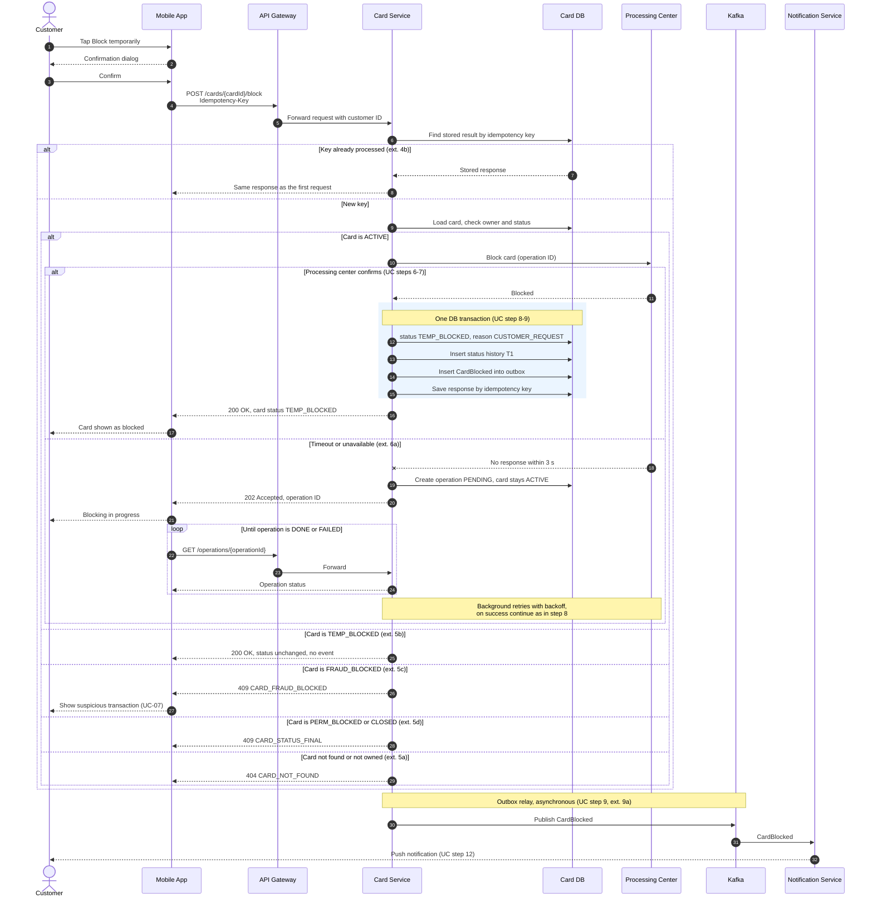

# SD-UC-02 Temporarily Block a Card

Sequence diagram for [UC-02](../../02-requirements/use-cases/UC-02-temp-block.md). Arrow numbers are the diagram's own; "UC step" and "ext." in notes refer to the use case. Containers are described in [containers.md](../containers.md).

## Main Scenario and Key Extensions

## Notes

- **Status check and update** are protected by optimistic locking on the card version. If the status changed between reading and writing (ext. 5e), the Card Service re-reads the card and re-evaluates the request.
- **Processing center call** carries the operation ID, so a background retry never creates a second block operation on the processing side.
- **Outbox relay** is a separate process inside the Card Service that reads unpublished outbox records and publishes them to Kafka. Publishing does not block the customer's response.