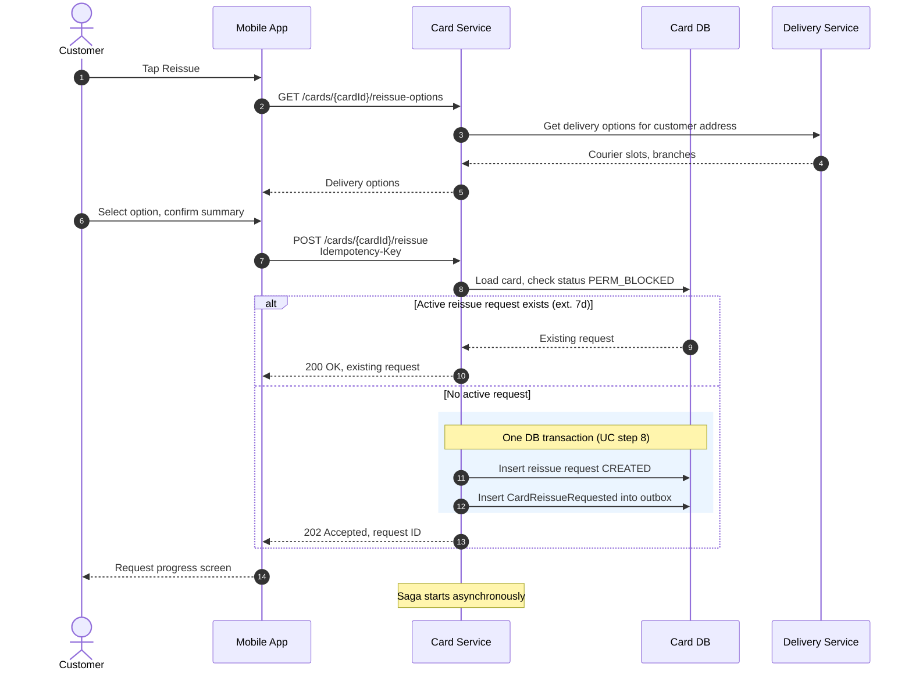
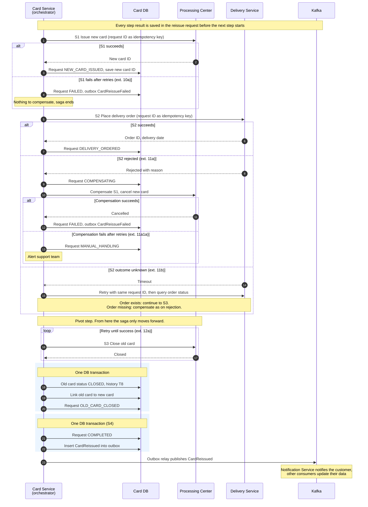

# SD-UC-05 Reissue a Card (Saga)

Sequence diagrams for [UC-05](../../02-requirements/use-cases/UC-05-reissue.md). The reissue is split into two diagrams: the customer placing the order (synchronous) and the saga run by the Card Service (asynchronous). Containers are described in [containers.md](../containers.md).

## 1. Placing the Reissue Request

## 2. Reissue Saga

## Notes

- **Saga state is persisted** before and after every external call. After a restart, the orchestrator loads all requests in intermediate statuses and resumes each from its last completed step (UC-05, ext. \*a).
- **Every external call is idempotent** thanks to the reissue request ID, so a resumed or retried step never issues a second card or places a second order.
- **Compensations are also idempotent and retried.** If a compensation cannot be completed, the request goes to `MANUAL_HANDLING` instead of being left in an intermediate state.