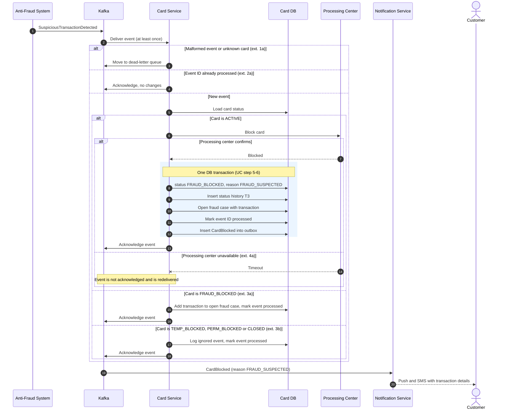
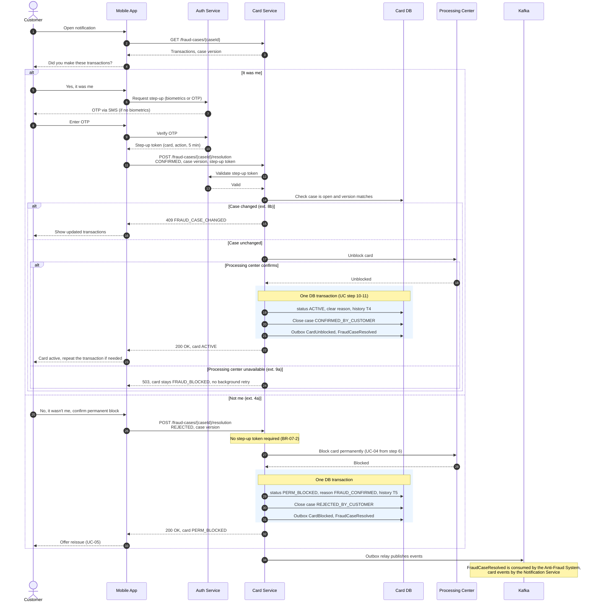

# SD-UC-06-07 Anti-Fraud Block and Customer Response

Sequence diagrams for [UC-06](../../02-requirements/use-cases/UC-06-fraud-block.md) and [UC-07](../../02-requirements/use-cases/UC-07-fraud-confirm.md). The two use cases form one flow: the anti-fraud system blocks the card, and the customer later confirms or rejects the suspicious transaction. Containers are described in [containers.md](../containers.md).

## 1. UC-06 Anti-Fraud Block

## 2. UC-07 Customer Response

## Notes

- **Case version** protects against the race in UC-07, ext. 8b: the customer's answer is accepted only for the exact set of transactions they saw.
- **Step-up token** is short-lived and bound to the customer, the card and the action, so it cannot be reused to unblock another card or for another action.
- **FraudCaseResolved** is published for both answers, giving the anti-fraud system feedback on false positives and confirmed fraud.